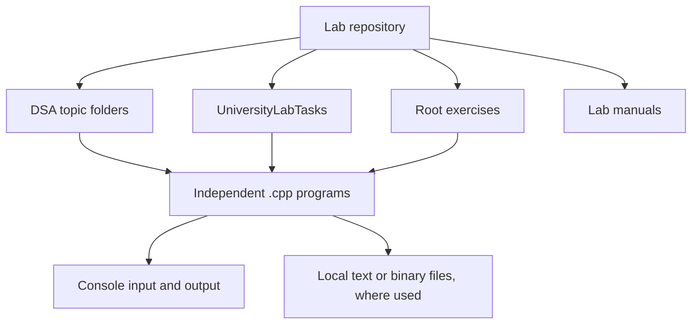

# C++ Data Structures and Algorithms Lab

A collection of **248 standalone C++ exercises** from programming fundamentals and data structures labs. Each `.cpp` file is generally its own console program with its own `main()` function. The repository is organized by topic, not as one application or library.

## Repository layout

| Path | Contents |
| --- | --- |
| `bubbleSort/`, `insertionSort/`, `selectionSort/`, `MergeSort/`, `QuickSort/` | Sorting demonstrations |
| `LinkedList/`, `Stack/`, `Queue/`, `Trees/` | Core data structure implementations and exercises |
| Root `.cpp` files | Dynamic and jagged arrays, records, puzzles, and other standalone exercises |
| `Cross-word-puzzle/` | Larger console crossword game with accounts and leaderboard |
| `UniversityLabTasks/` | Programming fundamentals exercises, arrays, functions, pointers, file handling, quizzes, and console games |
| `LabManuals/` and `DSA MANUAL.pdf` | Course reference material |

## Architecture



There is **no shared entry point, build system, or common module**. Compile one source file at a time; compiling all sources together causes multiple `main()` definitions. Most programs use standard C++ and console I/O. Some games and university exercises use Windows console APIs, `<conio.h>`, or `<dos.h>`. `Cross-word-puzzle/main.cpp` also uses GCC's `<bits/stdc++.h>` header.

The larger examples keep their data structures and program flow in a single source file:

- `LinkedList/`: singly, doubly, and circular linked list variants.
- `Stack/`, `Queue/`, `Trees/`: stack, queue, priority queue, tree, and binary search tree exercises.
- `Cross-word-puzzle/main.cpp`: clue/grid state, account handling, gameplay, scoring, and leaderboard persistence. It reads and writes `users.txt` and `leaderboard.txt` relative to the **current working directory**.
- `puzzle.cpp`: crossword state in a class; reads `puzzle_data.txt` from the current working directory.
- `UniversityLabTasks/`: independent tasks grouped by lesson. File handling examples may read or create files; some contain old absolute Windows paths that need editing before use on another machine.

## Build and run

Install a C++ compiler such as GCC/MinGW-w64. From the repository root in PowerShell:

```powershell
g++ -std=c++17 -Wall -Wextra "Trees/BstImplementation.cpp" -o bst.exe
./bst.exe
```

For a file that uses relative data paths, run it from its folder:

```powershell
cd Cross-word-puzzle
g++ -std=c++17 main.cpp -o crossword.exe
./crossword.exe
```

On Linux or macOS, use an output name without `.exe` for portable programs. Windows-specific examples require a compatible Windows toolchain and console. Some exercises are learning drafts and may require fixes before compiling or behaving as intended.

## Data and repository hygiene

The `.gitignore` excludes compiled binaries, editor files, and known generated account, score, and record files. It keeps source code, manuals, and sample text data. Check local text and binary data before publishing: several exercises write records in their working directory. Existing binaries already tracked by Git would need `git rm --cached` to stop tracking; `.gitignore` only affects untracked files.

No license is declared. Add one if you want to grant reuse rights.
